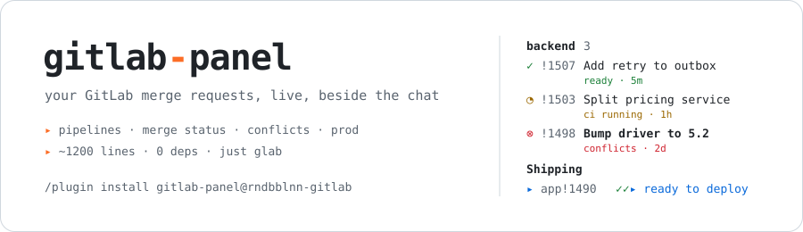
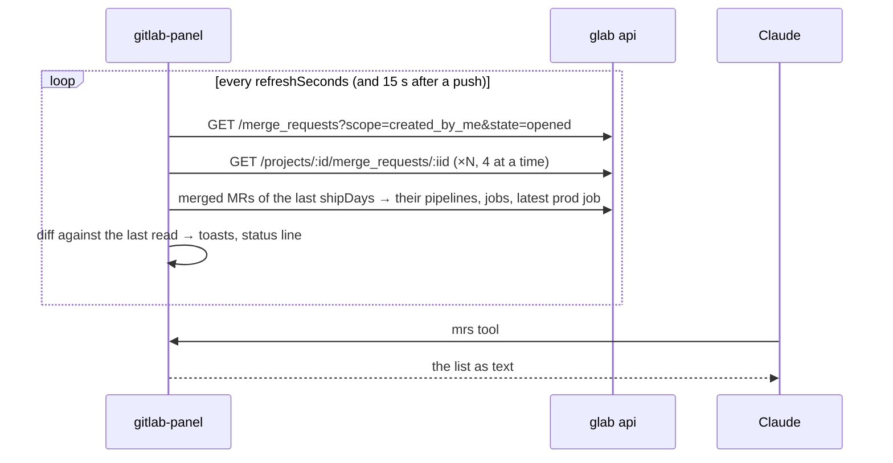

<div align="center">

<picture>
  <source media="(prefers-color-scheme: dark)" srcset="assets/banner-dark.svg">
  <source media="(prefers-color-scheme: light)" srcset="assets/banner-light.svg">
  
</picture>

### Your merge requests, without the browser tab.

**A live Claude Code pane for your open GitLab MRs: head pipeline, merge status, conflicts, comments, and how far each merged MR is from prod.**

[](LICENSE)
[](https://docs.claude.com/en/docs/claude-code)
[](https://github.com/rndbblnn/cc-mod-gitlab/tags)


**[Install](#install-30-seconds)** · **[Anatomy](#anatomy-of-the-pane)** · **[How it works](#how-it-works)** · **[Limits](#evidence-and-limits)** · **[FAQ](#faq)**

</div>

<br>

Claude pushes a branch and opens an MR. Then you switch to the browser to see whether the pipeline is green, whether it conflicts, whether someone commented, and whether yesterday's merge has reached prod.

**gitlab-panel** keeps that view docked beside the chat and updates it while you work. It uses the `glab` CLI you're already signed in with, so there's no token to configure and no server to run.

## Is it for you?

- You keep **several MRs open** across a few GitLab projects and want their state at a glance.
- You let **Claude push and open MRs** and want to see the pipeline react without leaving the terminal.
- You want to know **when your merged work is live**, or which deploy job is waiting on you.

If you use GitHub instead of GitLab, this panel won't help you.

## Install (30 seconds)

```
/plugin marketplace add rndbblnn/cc-mod-gitlab
/plugin install gitlab-panel@rndbblnn-gitlab
```

You need [`glab`](https://gitlab.com/gitlab-org/cli) on your `PATH` and signed in (`glab auth status`). Restart Claude Code, and the pane opens on the right.

In the desktop app, where `/plugin` doesn't run, click **+** next to the prompt box, choose **Plugins → Add marketplace**, enter `rndbblnn/cc-mod-gitlab`, then click **Add plugin**.

## Anatomy of the pane

```
1 failing ∙ 12s ago                          failing · blocked · last read

backend 3                                    project, MR count
  ✓ !1507 Add retry to outbox   ready    5m  pipeline · !iid · title · merge status · age
  ◔ !1503 Split pricing serv⋯   ci running 1h
  ⊗ !1498 Bump driver to 5.2    conflicts 2d  bold: needs you (red CI, conflicts, rebase)

app 1
  ▸ !1512 New checkout          draft   20m  drafts are dim

Shipping                                     your merged MRs on their way to prod:
  ✓ app!1490      Fix VAT  ✓✓✓ in prod    3h  live
  ▸ backend!1494  Outbox   ✓✓▸ ready to deploy  prod job waiting on a manual play
  ◔ backend!1489  Retry    ✓◔  deploying   1m  one mark per pipeline stage

refresh                                      r
✓ passed  ◔ running  ⊗ failed  ▸ manual      legend: only the glyphs on screen
```

- **Merge status in one word:** `ready`, `needs approval`, `threads open`, `ci running`, `ci must pass`, `conflicts`, `needs rebase`, `blocked`, `draft`.
- **Projects in your order:** they're grouped and sorted the way you list them in `projects`.
- **Changes arrive as toasts.** A pipeline turning red, a new conflict, or an MR reaching prod pops up between reads.
- **Status line:** `⇄ 4 MRs ∙ 1 ⊗ ∙ 1 conflict ∙ 2 ready ∙ 1 to deploy ∙ /gitlab`.
- **Every glyph is one cell wide** in any monospace font, so columns stay aligned.

Press a row to open it in the browser: the MR, or for a Shipping row the pipeline to act on.

## Act on an MR

`/gitlab <project>!<iid>` (or a pasted MR URL) opens an MR's detail view: branches, pipeline, comment count, age and reviewers.

| Key | Action |
| --- | --- |
| <kbd>o</kbd> | Open in the browser (in a given Chrome profile, if `chromeProfile` is set) |
| <kbd>y</kbd> | Copy the link |
| <kbd>g</kbd> | Copy the source branch |
| <kbd>c</kbd> | Post a comment (markdown, <kbd>enter</kbd> sends) |
| <kbd>r</kbd> | Re-read this MR now |
| <kbd>b</kbd> | Back to the list |

## Claude reads it too

The panel registers an `mrs` tool, which returns the same list as text, plus the Shipping section. When Claude needs to know whether your MR is mergeable, it asks the panel instead of calling `glab` itself.

When Claude runs `git push`, `glab mr …` or `glab api …`, the pane re-reads 15 s later, after GitLab has caught up.

## How it works

The panel is one hooks module on Claude Code's mod API. Every GitLab read goes through `glab api`, nothing else.



| Hook | What the panel does with it |
| --- | --- |
| `session.start` | Registers `/gitlab` and the `mrs` tool, reads once, starts a 1 s clock (polling, the post-push re-read), opens the pane once per session |
| `command.run` · `gitlab` | Show/hide, `refresh`, or open one MR's detail |
| `tool.call` · `mrs` | Answers from the last read (re-reads first if asked to, or if nothing has been read yet) |
| `tool.call` · `Bash` | Schedules a re-read when the command pushes or touches an MR |
| `ui.render` · `Pane` | Draws the list, the Shipping section and the detail view |

**Is it in prod?** A merged MR is **live** when its merge commit is an ancestor of the commit the latest successful prod job deployed (`prodJobs` names that job per project). If it isn't live yet, its state comes from its own merge-commit pipeline: `building`, `failed`, `ready to deploy` (prod job is a manual play), `deploying`, or `deploy #N` when a newer pipeline is the one to play.

## Small enough to read

| File | Lines | What's in it |
| --- | --: | --- |
| [`hooks/model.ts`](hooks/model.ts) | 324 | Pure logic: GitLab parsing, project filter, fetch, ordering, diffs, labels, the `mrs` text. No I/O, unit-tested |
| [`hooks/ship.ts`](hooks/ship.ts) | 286 | Pure logic for Shipping: prod-job rules, stage roll-up, live-or-not, states. Unit-tested |
| [`hooks/register.tsx`](hooks/register.tsx) | 510 | The hooks, `glab` calls and the JSX the pane draws |
| [`types/index.d.ts`](types/index.d.ts) | 91 | The state contract: `MR`, `Ship`, `Change` |

Zero runtime dependencies: every import comes from Claude Code itself. Network access only goes through `glab`, and no files are written. State lives in the session (`$.state`).

## Evidence and limits

- ✅ **List, merge status, toasts, status line, comments, detail view, Shipping**: used daily against gitlab.com, plus 20 unit and render tests.
- **Only your own MRs.** The list is `created_by_me`; MRs you review don't appear.
- **Capped reads.** The list reads 5 pages of open MRs and fetches detail for at most 50 of them. Shipping scans the last 300 successful jobs for the prod deploy.
- **The pane polls.** It doesn't use webhooks, so a change shows up within `refreshSeconds` (default 60 s).
- **Opening links** uses `google-chrome --profile-directory` when `chromeProfile` is set, otherwise `xdg-open`, then `open`.
- **Auto-open needs width.** Claude Code only docks a side pane by itself on a wide enough terminal. Otherwise, run `/gitlab`.
- **The mod API is early access** and may change between Claude Code releases.

## Commands and options

| Command | |
| --- | --- |
| `/gitlab` | Show or hide the pane |
| `/gitlab refresh` | Re-read now |
| `/gitlab <project>!<iid>` | Open one MR's detail (an MR URL works too) |

| Option | Default | |
| --- | --- | --- |
| `projects` | empty (all) | Comma-separated. A full path (`group/sub/name`) matches exactly; a bare name matches the last path segment. This order is the pane's order |
| `host` | `gitlab.com` | Passed to `glab api --hostname` |
| `glab` | `glab` | Path to the CLI |
| `refreshSeconds` | `60` | Polling interval. `0` = off |
| `openOnStart` | `true` | Open the pane when an interactive session starts (once per session) |
| `instructClaude` | `true` | Add a short, static note to the `mrs` tool's description |
| `prodJobs` | see `plugin.json` | `project=job name` pairs naming each project's prod deploy job; `*` is the fallback |
| `shipDays` | `1` | How far back Shipping looks for your merged MRs. `0` hides it |
| `shipMax` | `3` | At most this many merged MRs in Shipping |
| `chromeProfile` | empty | Chrome profile directory to open links in (e.g. `Profile 1`, see `chrome://version`) |

Set them in `/config`, or in `~/.claude/settings.json`:

```json
{ "pluginConfigs": { "gitlab-panel": { "options": {
  "projects": "backend, app, infra",
  "prodJobs": "app=deploy:production, *=deploy prod"
} } } }
```

## FAQ

<details>
<summary><b>The pane shows a red error line.</b></summary>
<br>

The panel shows the first line of `glab`'s stderr. Usually `glab` isn't signed in for that host: run `glab auth status` (or `glab auth login --hostname <host>`).
</details>

<details>
<summary><b>Does it work with self-hosted GitLab?</b></summary>
<br>

Yes. Set `host` to your instance's hostname and sign `glab` in to it.
</details>

<details>
<summary><b>Shipping is empty.</b></summary>
<br>

It only lists MRs you merged in the last `shipDays`, in projects whose prod job is named in `prodJobs` (or matched by `*`). If your deploy job has a different name, add `project=your job name`.
</details>

<details>
<summary><b>Does it cost tokens?</b></summary>
<br>

Only when Claude calls `mrs`. The tool's description is static, so it stays in the prompt cache.
</details>

<details>
<summary><b>Does it send anything anywhere?</b></summary>
<br>

Only GitLab API calls through your own `glab`, plus a comment when you post one. Nothing else leaves your machine.
</details>

## Repository layout

```
.claude-plugin/
  plugin.json        manifest + options
  marketplace.json   makes the repo installable with /plugin
hooks/
  hooks.json         points Claude Code at register.tsx
  register.tsx       the hooks, glab calls and the drawing
  model.ts           pure logic: MRs
  ship.ts            pure logic: Shipping
  *.test.ts(x)       claude plugin test
types/index.d.ts     state contract
CLAUDE.md            notes and gotchas for contributors (and their agents)
```

## Develop

```
git clone https://github.com/rndbblnn/cc-mod-gitlab && cd cc-mod-gitlab
claude plugin validate .
claude plugin test .
claude --plugin-dir .      # a session with your checkout loaded
```

Issues and PRs welcome. [`CLAUDE.md`](CLAUDE.md) lists the gotchas.

## See also

- [cc-mod-subagents-panel](https://github.com/rndbblnn/cc-mod-subagents-panel): every Claude Code subagent, live, beside the chat.

<div align="center">
<br>

**If it saved you a trip to the browser, a ⭐ helps others find it.**

MIT © [rndbblnn](https://github.com/rndbblnn)

</div>
